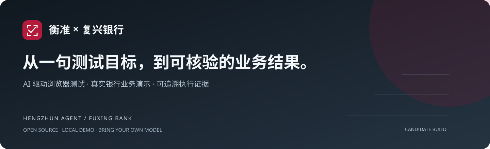
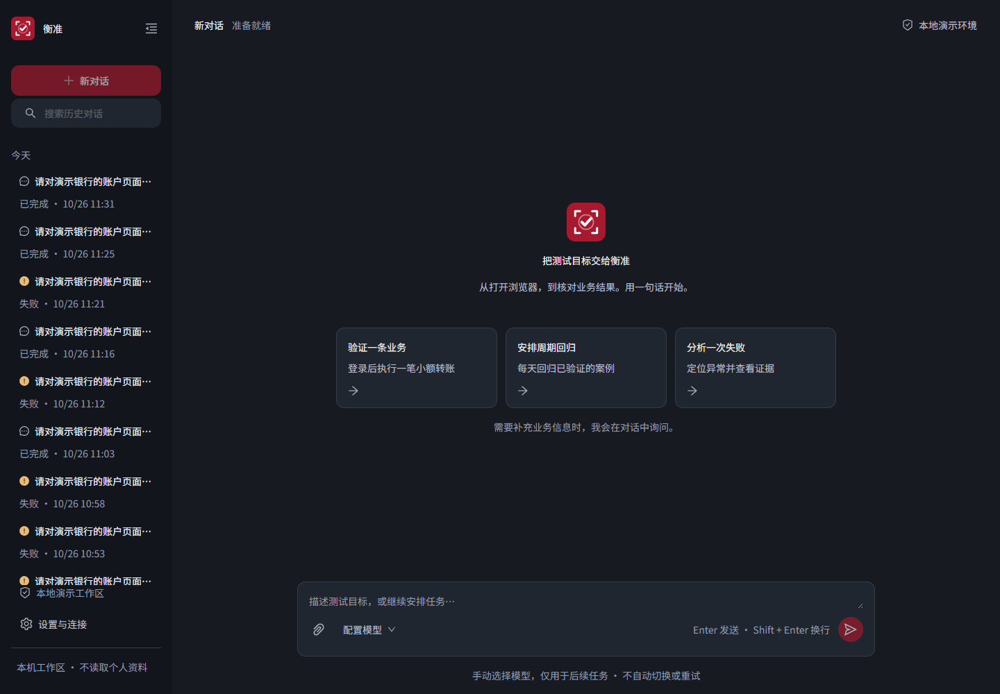
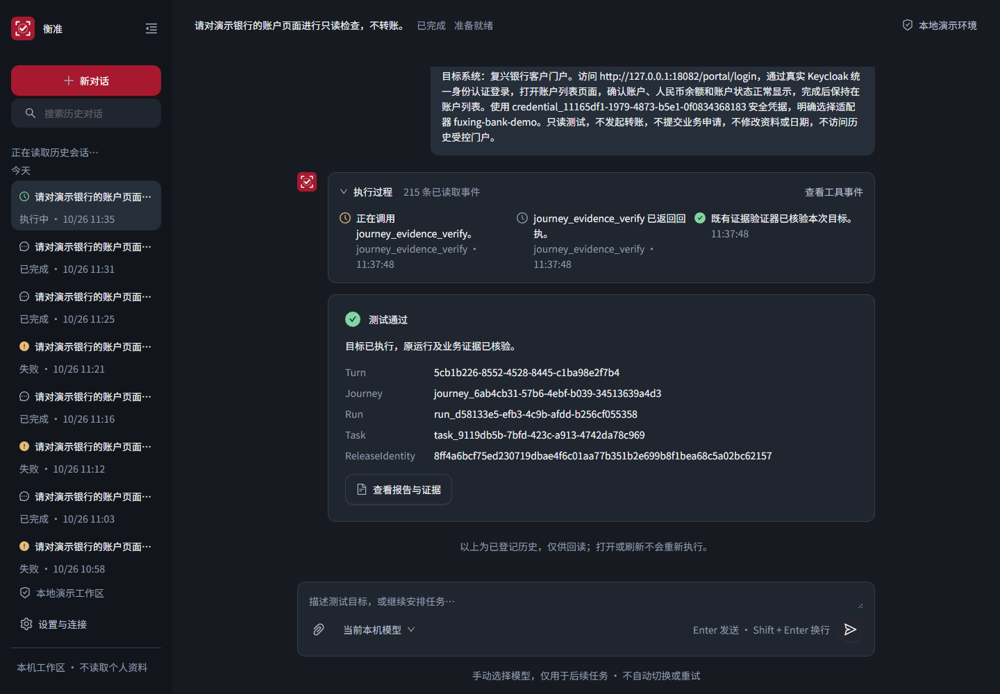
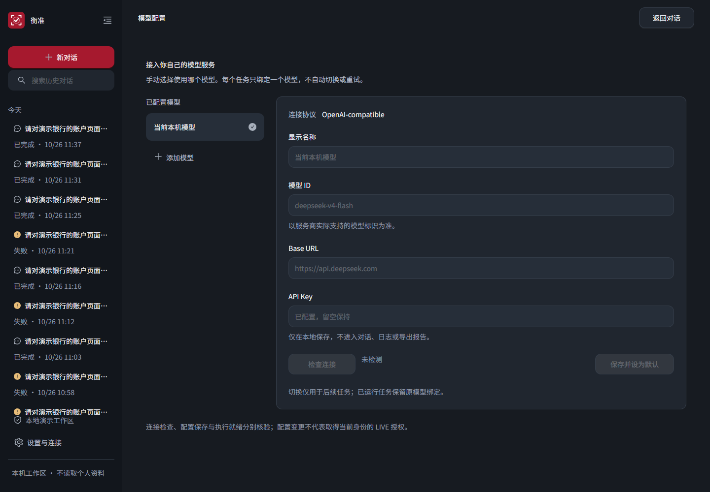

<p align="center"></p>

<p align="center"><a href="#产品实拍">产品实拍</a> · <a href="#开始演示">开始演示</a> · <a href="#系统如何协作">系统架构</a> · <a href="#交付进展">交付进展</a> · <a href="docs/README.md">开发文档</a></p>

<p align="center">


<a href="https://github.com/JunyeFu/banksystem/actions/workflows/ci.yml"></a>
</p>

## 把测试目标交给 Agent，把结果留给证据

**衡准（Hengzhun）** 是面向浏览器回归测试的 AI Agent：通过对话或 CLI 描述目标，生成测试、执行浏览器操作，并回读业务结果与证据。**复兴银行（Fuxing Bank）** 提供可本机运行的银行业务演示环境，让自动化测试有真实页面、真实服务与明确的业务判断标准。

项目起源于银行科技测试岗位的回归自动化课题：减少重复操作，让测试人员专注案例设计、失败分析与结果确认。使用合成演示数据，不接入真实资金。这是开发中的开源候选产品，不是生产银行系统。

| 衡准 · 测试工作台 | 复兴银行 · 业务演示系统 |
| --- | --- |
| 对话提交目标，查看工具执行事件与结果 | 客户登录、账户、转账、交易和贷款流程 |
| 历史会话、任务追踪、证据下载 | 运营查询、审批、文档、对账和日终编排 |
| BYOK 模型配置与任务级绑定 | Keycloak 身份认证，Fineract 核心账务 |
| CLI 与网页共享执行状态，Quality 只读投影 | Gateway → Bank Channel → Fineract 正式调用链 |

## 产品实拍

以下为 **2026-10-26 RF-068 S5 实机验收截图**，不是概念图或 AI 生成效果图。截图展示当时的本地演示环境，不代表当前提交已完成全部发布验证。工具事件是可观察执行记录，不是模型隐藏思维链。

### 一个对话框，承接测试任务



### 完成不止一句“通过”，还要可回读的结果



### 模型由你配置，任务保持明确绑定



截图来源见[展示资产说明](docs/showcase/README.md)。银行页面的[设计预览](docs/design/visual-acceptance/banksystem-v1/README.md)单独保留，**不混作实机截图**。

## 系统如何协作

```text
用户 ── 对话工作台 / hz-agent CLI
                 │
            Agent Controller ── BYOK 模型
                 │
                MCP
                 │
              Harness ── SQLite / 证据 ── Quality 只读门户
                 │
              Worker ── Playwright / Midscene
                                  │
                 客户门户 / 运营控制台
                                  │
                Gateway → Bank Channel → Fineract
```

Fineract 是银行账务真相源；Harness SQLite 是测试执行状态真相源。AI 作者化与已验证脚本的正式执行分离。Flowise、Coze、HiAgent 资料仅保留为研究历史，不是产品运行依赖或回退路径。

## 开始演示

准备 Windows 11、Docker Desktop，以及项目要求的 Node / Java / Python 工具链。模型使用 `HENGZHUN_MODEL_NAME`、`HENGZHUN_MODEL_BASE_URL`、`HENGZHUN_MODEL_API_KEY` 三变量配置；密钥只保存在本机，不提交到仓库。版本见[版本锁](infra/versions.lock.yaml)。

```powershell
git clone https://github.com/JunyeFu/banksystem.git
cd banksystem

# 先在本机配置 BYOK 三变量，再准备、启动和检查。
.\demo.ps1 prepare
.\demo.ps1 up
.\demo.ps1 status

# 合成银行账户之间的真实转账，会改变演示账户余额。
.\demo.ps1 run-golden-path

# 缺少当前完整发布证据时返回 NO_GO / 退出码 5。
.\demo.ps1 verify
```

首次构建和下载需要时间；等待 `up` 结束，以 `status` 输出为准，不承诺“五分钟冷克隆完成”。演示凭据由本机准备过程生成，不提供仓库内通用密码。

| 本机界面 | 默认地址 |
| --- | --- |
| 客户门户 | `http://127.0.0.1:18082/portal/` |
| 运营控制台 | `http://127.0.0.1:18083/ops/` |
| Quality 只读门户 | `http://127.0.0.1:18788/quality/` |
| Agent 会话工作台 | `http://127.0.0.1:18790`，需启动网页服务，见[Agent 说明](platform/hengzhun-regression-system/README.md) |

日常演示保持服务运行；需要停止时使用 `.\demo.ps1 down`，默认保留卷。不要把 `reset` 当作普通重启。Mifos 原生管理页是[可选管理员工具](docs/showcase/README.md#可选管理员工具)，不参与默认产品链路。

## 交付进展

**当前整体发布结论：NO_GO。源码同步不等于发布通过。**

| 范围 | 已有证据 | 尚需闭合 |
| --- | --- | --- |
| Agent 会话与只读银行测试 | RF-068 S5 在 2026-10-26 冻结身份下 LIVE_E2E 通过，10 阶段、10 检查、7 工件验证 | 不外推为任意模型、任意输入或新身份通过 |
| 银行业务与工程重构 | 五个 Fineract 端口、Repository 归属及业务修复进入本地源码 | 当前候选完整运行回归 |
| 正式产品验收 | RF-057 定义 14 银行 + 7 Agent + 7 性能场景 | 同一候选身份的正式 28 项与发布判定 |
| 供应链与分发 | 许可证说明、镜像审查与全产品 CI 配置 | RF-065 镜像候选、安全处置与远端 CI 结果 |

查看 [S5 验收与根因修复](docs/architecture/refactoring/batches/RF-068/S5-json-root-cause-20261026.md)、[能力矩阵](docs/current-state/capability-matrix.md)及 [GitHub Actions](https://github.com/JunyeFu/banksystem/actions)。历史 Full18 不作为当前发布要求；旧身份的证据不能替代新候选验收。

## 开发与贡献

| 你想了解 | 从这里开始 |
| --- | --- |
| 产品实现与文档导航 | [文档中心](docs/README.md) · [Agent 说明](platform/hengzhun-regression-system/README.md) |
| 接口与模块 | [API 合同](contracts/openapi) · [前端设计](docs/design/frontend/README.md) |
| 任务状态与实施顺序 | [Backlog](agent/backlog.yaml) · [唯一实施顺序](agent/plans/active/v54-implementation-batches.md) |
| 正式工程材料 | [文书目录](documents/README.md) · [Python 工具链](docs/operations/development-environment/python-toolchain.md) |
| 参与项目 | [贡献指南](CONTRIBUTING.md) · [安全说明](SECURITY.md) · [行为准则](CODE_OF_CONDUCT.md) |

项目自有代码使用 [MPL-2.0](LICENSE)。第三方组件保留各自许可证，见[第三方声明](THIRD-PARTY-NOTICES.md)；根许可证不替代第三方分发条件。变更记录见 [CHANGELOG](CHANGELOG.md)。
