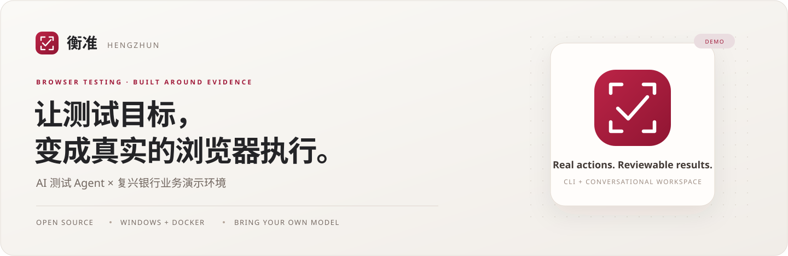

<p align="center">
  
</p>

<p align="center">
  <a href="#产品实拍">产品实拍</a> ·
  <a href="#开始演示">本地启动</a> ·
  <a href="#系统如何协作">系统架构</a> ·
  <a href="#交付进展">工程状态</a> ·
  <a href="docs/README.md">开发文档</a>
</p>

<p align="center">
  <a href="LICENSE"></a>
  
  
  <a href="https://github.com/JunyeFu/banksystem/actions/workflows/ci.yml"></a>
</p>

## 测试人员描述目标，Agent 完成真实操作

**衡准（Hengzhun）** 把对话或 CLI 中的测试目标转为真实浏览器操作，回读业务结果并保留证据；**复兴银行（Fuxing Bank）** 提供真实页面、服务与核心账务，使用合成账户和演示资金。异常会记录原因并交由人工处理。

> **开发快照 · 2026-11-06** — 当前完整发布结论为 **NO_GO**。已有真实只读与隔离工程证据，源码同步不是正式发布。[验证范围与剩余任务](#交付进展)。

## 产品实拍

### 从一句目标，到可回读的结果

下面展示一次**真实只读账户检查**：执行过程、Journey / Run 引用、验收身份和证据入口在同一工作台中呈现。

<p align="center">
  <a href="docs/showcase/agent-result.png"></a>
</p>

<table>
  <tr>
    <td width="50%" valign="top">
      <strong>一个工作台，管理目标与历史</strong><br><br>
      <a href="docs/showcase/agent-workbench.png"></a>
      <p>对话承接操作，历史会话保留任务上下文。</p>
    </td>
    <td width="50%" valign="top">
      <strong>模型由你配置，任务保持绑定</strong><br><br>
      <a href="docs/showcase/model-settings.png"></a>
      <p>BYOK 接入；本地保存密钥，不放进模型上下文。</p>
    </td>
  </tr>
</table>

以上三张截图均来自 **2026-10-26 RF-068 S5 实机验收**，未修改页面内容；不是设计图，也不是当前提交的重新验收。可观察工具事件不等于模型隐藏思维链。[截图来源与原始身份](docs/showcase/README.md) · [银行界面设计预览（非实拍）](docs/design/visual-acceptance/banksystem-v1/README.md)。

### 两个产品，一条可追溯的测试链

| 产品 | 核心能力 | 使用入口 |
| --- | --- | --- |
| **衡准 · AI 测试 Agent** | 对话提交目标、历史会话、模型绑定、执行事件与证据回读 | 会话工作台 / Windows CLI |
| **复兴银行 · 业务演示环境** | 客户登录、账户、转账、交易、贷款及运营查询 | Customer Portal / Operations Console |

你可以用自然语言描述“登录演示银行并检查账户余额”，由 Agent 规划与执行，再通过运行记录核验结果。银行业务以 Fineract 回读为准，测试状态以 Harness SQLite 为准；失败不会被包装成成功。

已验证脚本与 AI 作者化分离：正式回归执行消费已验证脚本。周期回归、完整业务与容量能力的验收范围，见下方工程状态，不以工作台入口存在代替通过证据。

项目源于银行科技测试岗位的回归自动化课题。目标是把测试人员从重复操作中释放出来，保留案例设计、失败介入和结果确认的判断权；不承载真实存款，也不是生产银行系统。

## 开始演示

需要 **Windows 11 + Docker Desktop**，以及项目要求的 Node / Java / Python 工具链。首次下载和镜像构建需要时间，不承诺冷克隆“五分钟完成”。

```powershell
git clone https://github.com/JunyeFu/banksystem.git
cd banksystem

# 先在本机配置 BYOK 三变量，再准备、启动和检查。
.\demo.ps1 prepare
.\demo.ps1 up
.\demo.ps1 status
```

模型配置仅使用 `HENGZHUN_MODEL_NAME`、`HENGZHUN_MODEL_BASE_URL`、`HENGZHUN_MODEL_API_KEY`。演示凭据由本机准备流程生成；仓库不提供通用密码，不上传本地密钥。

| 界面 | 默认地址 |
| --- | --- |
| 客户门户 | `http://127.0.0.1:18082/portal/` |
| 运营控制台 | `http://127.0.0.1:18083/ops/` |
| Quality 只读门户 | `http://127.0.0.1:18788/quality/` |
| Agent 会话工作台 | `http://127.0.0.1:18790`，需启动网页服务，见[Agent 使用说明](platform/hengzhun-regression-system/README.md) |

<details>
<summary><strong>黄金业务、发布核验与停止服务</strong></summary>

```powershell
# 合成账户间的真实转账，会改变演示账户余额。
.\demo.ps1 run-golden-path

# 缺少当前完整发布证据时，返回 NO_GO / 退出码 5。
.\demo.ps1 verify

# 仅在需要停止时使用；默认保留数据卷。
.\demo.ps1 down
```

日常演示可以持续保持服务运行，不把 `reset` 当作普通重启。Mifos 原生管理页是[可选管理员工具](docs/showcase/README.md#可选管理员工具)，不在默认产品链路中。

版本以[运行冻结配置](platform/hengzhun-regression-system/config/demo-runtime-freeze.json)、依赖锁、服务 POM / Dockerfile 和 [Compose](compose.channel.yaml) 为准。[早期版本锁](infra/versions.lock.yaml)仅保留历史记录。

</details>

## 系统如何协作

```text
对话工作台 / hz-agent CLI
           │
     Agent Controller ── BYOK 模型
           │
          MCP
           │
       Harness ── SQLite / 证据 ── Quality 只读门户
           │
        Worker ── Playwright / Midscene
                            │
                Customer Portal / Operations Console
                            │
                 Gateway → Bank Channel → Fineract
```

**账务归核心，执行归 Harness，模型不直接写状态。** 浏览器只走 Gateway → Bank Channel → Fineract 正式银行调用链。Flowise、Coze、HiAgent 资料仅为研究历史，不是运行依赖或回退路径。

## 交付进展

当前是**可继续开发与演示的候选源码**，不是已通过全部发布门的 v1.0。GitHub 徽章只反映远端对应提交的 CI；本地、历史身份和隔离镜像证据分别记录。

| 验证层 | 最近已核实结果 | 不能据此推导 |
| --- | --- | --- |
| Agent 源码 | 隔离注册测试 **841/841**；覆盖率行 / 分支 / 函数 59.80% / 74.37% / 62.53% | 当前身份 LIVE 或远端全仓 CI 通过 |
| Java 与集成 | Java21 **121/121**、PG18.6 双迁移；新 MQ 认证、事务、持久重建与 Console 通过 | 原部署已升级，或完整银行业务验收通过 |
| 真实模型验收 | 2026-11-05 的 S5 只读验收通过，身份 `1c76996e…ca3e94d` | 后续源码、任意模型或正式 28 项通过 |
| 正式产品门 | RF-057：**14 银行 + 7 Agent + 7 性能** | 28 项清单已全部执行或发布 GO |

<details>
<summary><strong>查看供应链、资料及剩余发布门</strong></summary>

| 范围 | 当前证据 | 尚未闭合 |
| --- | --- | --- |
| MQ 候选 | 去除四个未消费 GPG / SQLite 包；原生60→49（移除11 / 新增0），2项已审、47项阻断；保留应用、JRE与信任库 | Expat 字体链、shadow、gpgtar 等剩余风险仍需逐项处理 |
| 其它供应链 | Channel 62项精确审查；PG132项中14项已审、118项阻断；NPM剩余2处包 / 3条公告 | 其它镜像、待选版本、完整分发义务和统一候选 |
| 交付与性能 | 正式清单及补充容量驱动已有实现 | 同一最终身份的28项、130次真实只读任务、两小时观察、隔离复现与远端CI |
| 工程与面试资料 | 七份本地 Word 草稿完成35页逐页检查，八项默认面试稿已准备 | 本人贡献核实 / UAT / 演练，以及最终候选交接；不代替机构签收 |

[能力矩阵](docs/current-state/capability-matrix.md) · [11月5日真实验收](docs/evidence/platform/agent-interview-repair-2026-11-05.md) · [Agent 源码门](docs/architecture/refactoring/batches/RF-065/ci-complete-20261105.md) · [MQ 候选修复](docs/architecture/refactoring/batches/RF-065/mq-library-security-20261106.md) · [PG 风险](docs/architecture/refactoring/batches/RF-065/pg-library-surface-20261106.md) · [GitHub Actions](https://github.com/JunyeFu/banksystem/actions)。

原银行服务、数据、卷和业务日期保持。历史 Full18 不再是当前发布要求，旧证据不换算为新身份的通过结果。

</details>

## 开发与贡献

[文档中心](docs/README.md) · [Agent / CLI](platform/hengzhun-regression-system/README.md) · [API 合同](contracts/openapi) · [前端设计](docs/design/frontend/README.md) · [正式文书](documents/README.md)

[贡献指南](CONTRIBUTING.md) · [安全策略](SECURITY.md) · [行为准则](CODE_OF_CONDUCT.md) · [路线说明](ROADMAP.md) · [变更记录](CHANGELOG.md)

工程状态只以 [Backlog](agent/backlog.yaml) 为准，顺序只以[唯一实施顺序](agent/plans/active/v54-implementation-batches.md)为准；公开路线说明不另设并行任务控制。

---

自有代码使用 [MPL-2.0](LICENSE)。Apache Fineract、Mifos 及其它第三方组件保留原许可证和归属，见[第三方声明](THIRD-PARTY-NOTICES.md)；根许可证不替代它们的分发条件。
